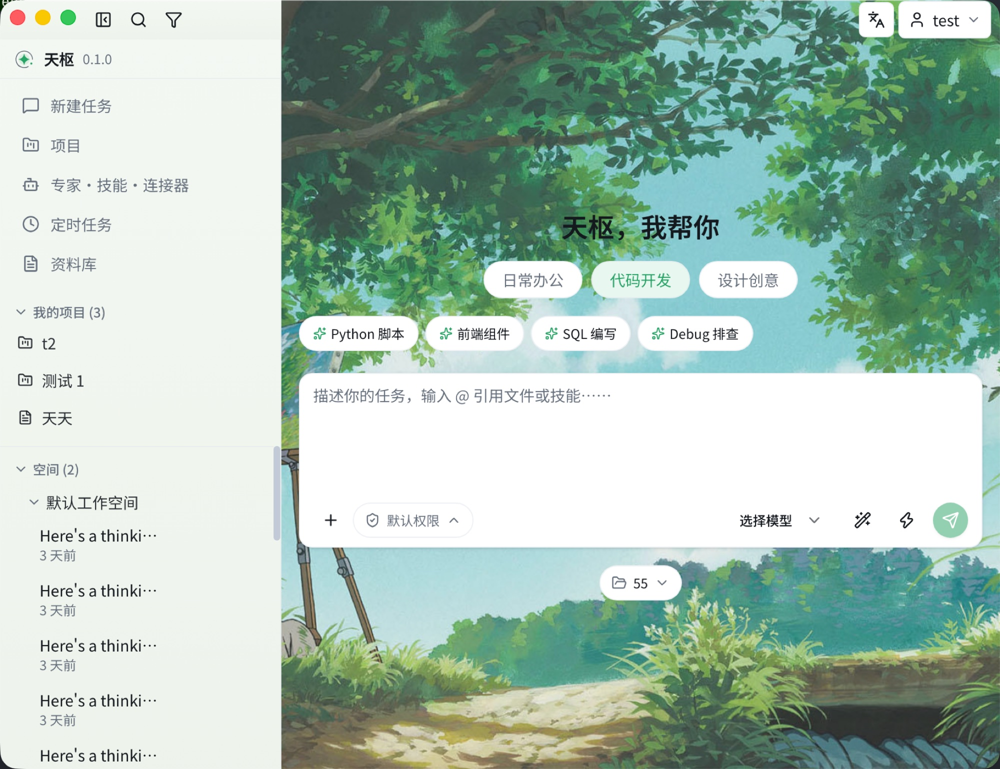

# 天枢 · Tianshu

> 天枢者，北斗第一星（Dubhe）——斗柄所指，众星拱之。核心枢纽，由此开启。

**本地优先的 AI 桌面工作台**：对话与 Agent、多厂商模型、MCP 连接器、技能、长期记忆、自动化、内置浏览器、流程编排、项目与计划、用量监控——全部装进一个 Electron 应用，数据留在你自己的电脑上；配套无头服务端，桌面单界面可切换并全功能遥控远程主机。

[English](README.en.md) · [特性](#-特性) · [快速开始](#-快速开始) · [架构](#-架构) · [安全说明](#-安全说明)




## ✨ 特性

### 🤖 多模型对话

- 接入 **OpenAI 兼容**、**Anthropic**、**Gemini** 与 **Ollama**（本地模型）四类服务商，模型统一管理、随时切换
- 助手预设（专家）、技能、MCP 连接器在统一入口管理，可在会话中直接选用
- Markdown 渲染 + Shiki 代码高亮，`@` 引用本地文本文件随消息发送

### 🛠 Agent 能力

- **文件工具**：会话绑定工作空间目录后，AI 获得 `read` / `write` / `ls` / `grep` 四个工具，路径全部限定在该目录内
- **终端工具**：`bash` 执行 shell 命令，60s 超时、输出截断回喂；`rm -rf /`、fork 炸弹等破坏性命令硬拦截，与权限级别无关
- **两级权限**：默认权限下文件写与命令逐次审批；切换「完全访问」需全屏风险确认，且为会话级内存态，重启即回默认
- **三种会话模式**：Agent（全能力）/ 问答 ASK（纯对话）/ 计划 PLAN（先出完整计划、确认后才动手）

### 🔌 MCP 连接器

- 接入任意 [Model Context Protocol](https://modelcontextprotocol.io) 服务器，支持 **stdio** 与 **streamable HTTP**（含 Bearer 认证）两种传输
- 启动时自动连接全部启用项，页面提供连接状态徽标与启停/重连；标注只读的工具免审直接执行

### 📜 技能系统

- 技能即一个带 frontmatter 的 `SKILL.md`：用户级放 `<userData>/skills/`，工作空间级放 `.tianshu/skills/`，放目录即生效、免重启
- 技能清单注入 system prompt，模型按需读取正文；AI 也可以在对话中直接为你创建技能

### 🧠 长期记忆

- 对话之外维护一份本地 Profile 记忆：后台定时整理 + 手动触发，经模型编译后持久化，让 AI 越用越懂你

### ⏱ 自动化

- 定时调度的 AI 任务（cron 式配置），自动拉起会话执行并留存每次运行记录与统计

### 🔀 流程编排

- 可视化编排图编辑器：画布与 JSON 源码双模式双向同步、实时校验、错误点击定位节点
- 试运行（变量表单 + 工作空间选择）、运行历史、版本乐观锁；编排图可挂到自动化任务调度执行

### 🌐 内置浏览器

- AI 模块内置多标签浏览器：页内导航工具栏、查找条、设备模拟，每个标签常驻独立 webview

### 📊 用量监控

- LLM 调用与工具调用全程留痕，监控页按场景聚合：KPI、7 天趋势、模型分布、工具排行

### 🖥 无头服务端与多主机

- `apps/tianshu-server`：同一套核心逻辑打包为独立无头服务端（NestJS），可部署到服务器常驻运行
- 桌面端「主机」页管理无头端连接；经主机切换器在本地与远程主机间无缝切换——聊天、会话、模型配置、专家、技能、审批对远程主机全功能可用
- 连接支持直连与中继（relay），中继链路端到端加密

### 📁 项目与计划

- 项目 hub + 项目工作台：项目成员、能力挂载（把专家/技能/MCP 绑定到项目）
- 计划项支持 **表格 / 列表 / 看板 / 甘特 / 日历** 五种视图，任务与 AI 会话双向关联

### 📚 资料库

- 沉淀对话中值得留存的资料，供后续会话引用

### 🎨 外观与本地化

- 浅色 / 深色模式 + 多套壁纸皮肤主题，卡片式预览即点即换
- 中英双语（zh-CN / en-US），界面语言一键切换

### 🏗 工程基础

- **本地认证**：多账号 + JWT 守卫，v12 起所有业务表按 userId 隔离
- **版本化迁移**：Prisma + SQLite，`script/vN` 逐版本升级，启动时自动执行
- **自动更新**：electron-updater + generic 更新源，未配置时自动禁用
- **日志与审计**：Winston 按日轮转；安全审计日志留痕敏感操作
- **测试**：Vitest 单测覆盖核心逻辑（Agent 循环、权限、迁移、仓储等）

## 🧱 架构

```
├── electron/               # 主进程
│   ├── Application.ts      # 启动入口与 IPC 接线
│   ├── commons/            # 日志 / Prisma / IPC 工具
│   ├── infrastructure/     # 版本化 SQL 迁移脚本
│   └── domains/            # 业务域：ai / project / option / user / app-settings /
│                           #       security / server / server-face（entity + repo）
├── src-react/              # 渲染进程
│   ├── components/         # shadcn/ui 公共组件
│   ├── domains/            # 业务域前端（api / views / components / store）
│   ├── i18n/               # zh-CN / en-US 翻译
│   └── routes/ lib/ styles/
├── apps/                   # 子应用（git subtree 并入，npm workspaces 管理）
│   ├── tianshu-server/     # 无头服务端（NestJS）
│   └── tianshu-mobile/     # 移动控制端（Expo / React Native）
├── packages/               # 三端共享包
│   ├── tianshu-protocol/   # 协议与常量（纯类型，零运行时依赖）
│   └── tianshu-core/       # 共享核心逻辑（chat 工具循环、blocks 序列化、E2E 加密）
├── prisma/schema.prisma    # 数据模型
├── tests/                  # Vitest 单测
└── scripts/                # 脚手架脚本（init 等）
```

**技术栈**：Electron 44 · React 19 · TypeScript 5.9 · Vite 8 · Prisma 7 + SQLite (better-sqlite3) · Tailwind CSS 4 · shadcn/ui + Radix · Zustand · React Query · React Router 7 · LangChain（@langchain/core + Anthropic / OpenAI / Gemini / Ollama）· MCP SDK · NestJS（无头端）· Vitest

每个业务域前后端一一对应（`electron/domains/<x>` ↔ `src-react/domains/<x>`），新增域的七步流程见 [docs/guide.md](docs/guide.md)。

## 🚀 快速开始

**前置要求**：Node.js ≥ 22.12（Electron 44 要求）；全局安装 node-gyp（native 依赖编译需要）：

```bash
npm i -g node-gyp

# 安装依赖
npm install

# 开发调试
npm run dev
```

首次启动会自动创建本地 SQLite 并执行建表脚本；在登录页**注册第一个账号**即可使用。

```bash
npm run test        # 单测（Vitest）
npm run lint        # ESLint
npm run typecheck   # 类型检查
npm run build       # 打包
npm run check:drift # 双仓漂移巡检（与 tianshu-server 仍双份文件的基线守护）
```

> 想基于天枢改造成自己的应用（改名 / appId / 更新源）？运行 `npm run init`（幂等）。

## 🧩 各端开发

三端与共享包的开发启动/编译（在仓库根执行，`-w` 作用于对应 workspace）：

| 端 | 开发启动 | 编译 / 产物 |
| --- | --- | --- |
| 桌面端（根） | `npm run dev` | `npm run build`（Electron 安装包；tianshu-server 独立部署，不内嵌） |
| 无头服务端 `apps/tianshu-server` | `npm run start:dev -w apps/tianshu-server`（NestJS watch） | `npm run build -w apps/tianshu-server`（`dist/`；独立部署 `start:prod` / Dockerfile） |
| 移动控制端 `apps/tianshu-mobile` | `npm run start -w apps/tianshu-mobile`（Expo；`android` / `ios` 子命令挂模拟器） | —（经 Expo / EAS 发布） |
| 共享包 `packages/*` | 桌面端经 alias 直引源码，即改即用 | 改包后 `npm --prefix packages/tianshu-core run build` 重建 dist（server / mobile 消费） |

## 📖 文档

- [如何添加业务域 & AI 模块演进（P1–P3）](docs/guide.md)
- [自建更新服务器](docs/update-server.md)

## 🔐 安全说明

天枢沿用本地认证模式，适用于「防止路人直接打开应用」的单机场景：

- **JWT 签名密钥为内置常量**：介意者应在 `electron/domains/user/user.repo.ts` 的 `JWT_SECRET` 处替换为自己的随机密钥
- **密码为本地 SQLite 明文存储**：数据库文件仅存在于本机用户目录
- 该模式**不适用于**多用户或联网威胁模型；如需处理敏感数据，请自行加强（密码哈希、密钥管理、传输加密等）

## 🤝 贡献

欢迎 Issue 与 PR，中英文均可。提交前请跑 `npm run lint`、`npm run typecheck` 与 `npm run test`。

## 📄 许可证

[MIT](LICENSE)
